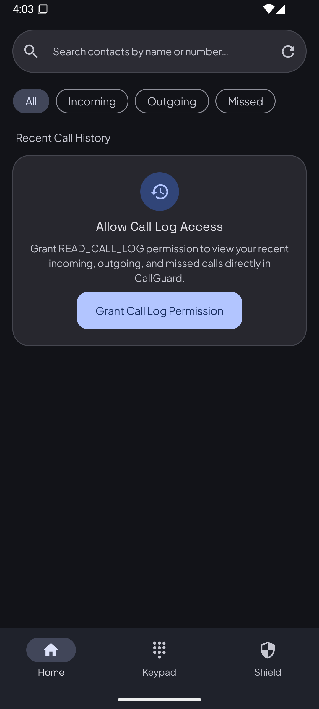
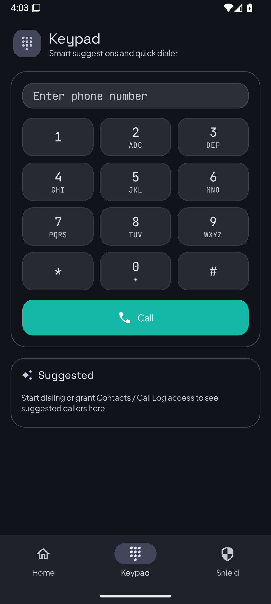
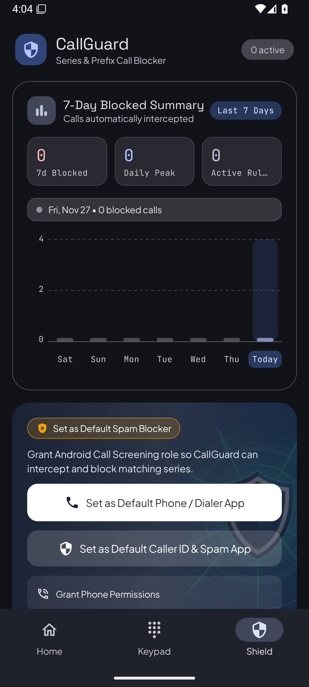
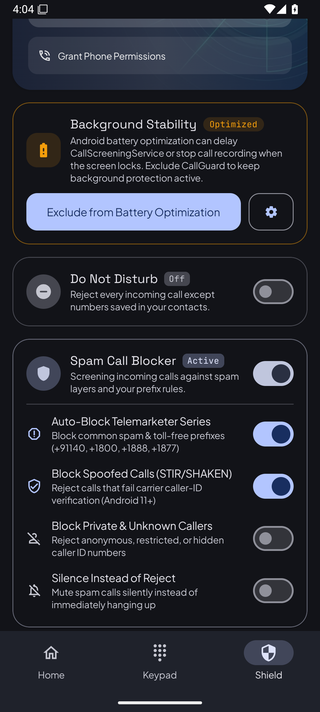
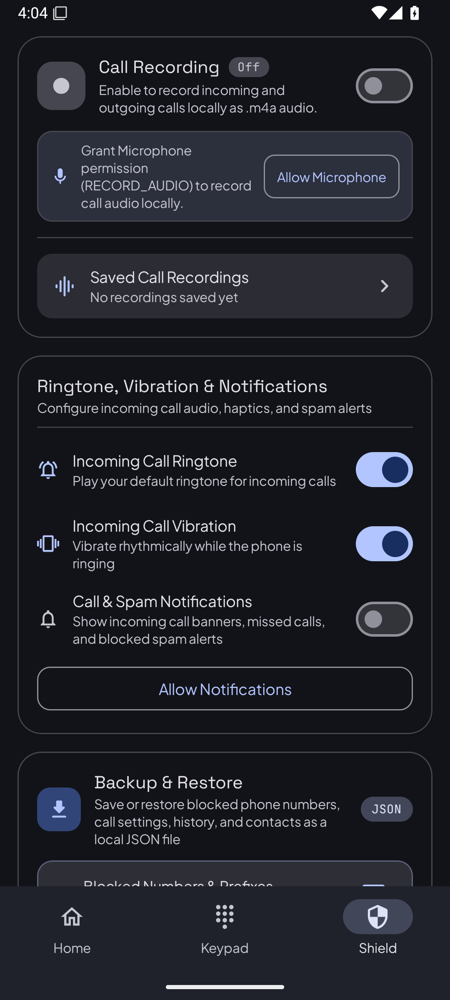
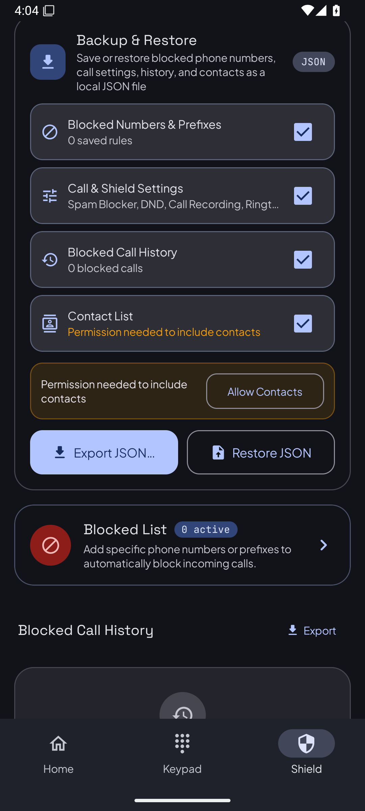

# CallGuard 🛡️

> **Zero Ads. 100% Offline & Privacy-First. Smart Dialer, Call Screening, Recording & On-Device Summarization.**

CallGuard is a modern, offline-first Android phone and call-protection application built with Kotlin and Jetpack Compose. Operating completely on-device with **no internet permission**, no cloud accounts, and no third-party tracking, CallGuard combines a native Material You dialer, layered spam & prefix call screening, local `.m4a` call recording with on-device conversation summaries, and portable JSON backup & restore.

---

## 📱 Screenshots

<table>
  <tr>
    <td align="center">
      <br />
      <sub><b>Home</b> — Universal Contact &amp; Call Log Search</sub>
    </td>
    <td align="center">
      <br />
      <sub><b>Keypad</b> — Quick Dialer &amp; Smart Suggestions</sub>
    </td>
    <td align="center">
      <br />
      <sub><b>Shield</b> — 7-Day Blocked Chart &amp; Role Setup</sub>
    </td>
  </tr>
  <tr>
    <td align="center">
      <br />
      <sub><b>Protection</b> — Battery Stability, DND &amp; Spam Rules</sub>
    </td>
    <td align="center">
      <br />
      <sub><b>Audio &amp; Alerts</b> — Call Recording &amp; Notifications</sub>
    </td>
    <td align="center">
      <br />
      <sub><b>Data &amp; Rules</b> — JSON Backup, Blocked List &amp; History</sub>
    </td>
  </tr>
</table>

---

## ✨ Features

### 📞 Smart Dialer & In-Call Experience
- **Home & Call History Feed:** Filter recent calls by **All**, **Incoming**, **Outgoing**, or **Missed**, search contacts and call logs simultaneously with anywhere-inside-string substring matching, and manage entries quickly with **swipe-to-delete** and **swipe-to-block** gestures.
- **Unknown Caller Auto-Categorization:** Automatically tags unknown numbers based on interaction frequency (e.g., *Frequent Caller*, *Potential Business*, *One-time Contact*) alongside on-device spam risk analysis.
- **Quick Keypad & Suggestions:** Numeric dialpad placed prominently above live smart caller suggestions drawn from contacts and recent history.
- **Custom Lockscreen In-Call UI:** Full-screen `InCallActivity` featuring animated **swipe-up Answer and Reject sliders**, mute, speakerphone, hold, DTMF keypad, and in-call recording controls.

### 🛡️ Layered Call Protection & Screening
- **Custom Blocked List & Prefixes:** Manually add exact phone numbers or number prefixes stored in Room and evaluated in real time by `PrefixCallScreeningService` before your phone rings.
- **Multi-Layer Spam Blocker:**
  - Auto-block common telemarketer and toll-free series (`+91140`, `+1800`, `+1888`, `+1877`).
  - Reject spoofed calls failing **STIR/SHAKEN** carrier verification (Android 11+).
  - Block private, restricted, or hidden caller IDs.
  - Optional **Silence Instead of Reject** mode and contacts-only **Do Not Disturb** mode.
- **7-Day Blocked Summary:** Interactive bar chart tracking blocked calls over the last 7 days, daily peak, and active rule count, plus a full exportable Blocked Call History log.
- **Background Stability:** Guided battery optimization exclusion flow (`REQUEST_IGNORE_BATTERY_OPTIMIZATIONS`) to keep call screening and call recording reliable when the screen is locked.

### 🎙️ Call Recording & On-Device Summarization
- **Local `.m4a` Call Recording:** Record incoming and outgoing calls locally (manual toggle or auto-record) with built-in async audio playback.
- **100% On-Device Conversation Summaries:** Decodes recorded audio locally via `MediaExtractor`/`MediaCodec` for voice-activity metrics, runs offline Android 13+ `SpeechRecognizer` when available, and applies local extractive NLP to generate summaries, action items, and topic tags—never uploading audio to any server.

### 💾 Backup, Privacy & Personalization
- **Local JSON Backup & Restore:** Export and restore your Blocked Numbers & Prefixes, Call & Shield Settings, Blocked Call History, and optional Contact List via a local `.json` file.
- **Material You Dynamic Color:** Adapts automatically to your Android 12+ wallpaper color palette with full dark/light theme and edge-to-edge support.
- **Zero-Network Privacy:** Declares **no `INTERNET` permission** in `AndroidManifest.xml`—every rule, recording, summary, and log stays strictly on your device.

---

## 🏗️ Architecture & Tech Stack

- **Language:** Kotlin (`2.4.21`) + Coroutines & Flow
- **UI:** Jetpack Compose (Material Design 3, Material You Dynamic Color, Compose Compiler stability configuration)
- **Architecture:** MVVM with unidirectional `StateFlow` UI state and off-main-thread analytics pipelines (`Dispatchers.Default` / `Dispatchers.IO`)
- **Telecom Integration:**
  - `CallGuardInCallService` (`InCallService`) & `CallSessionManager` for full dialer ownership
  - `PrefixCallScreeningService` (`CallScreeningService`) for real-time spam & prefix screening
- **Persistence:**
  - **Room** (`2.7.0` with KSP) for blocked prefixes/numbers, blocked call logs, and call recordings
  - **Jetpack DataStore Preferences** (`1.1.7`) for shield, audio, and alert settings
- **Release Optimization:** R8 code minification (`isMinifyEnabled = true`), resource shrinking (`isShrinkResources = true`), WebP drawables, and Android App Bundle language/density/ABI splits.

---

## 📋 Requirements

- **JDK:** JDK 21 (Temurin 21 recommended)
- **Android SDK:** Compile SDK `36`, Target SDK `36`, Min SDK `24` (Android 7.0+)
- **Android Gradle Plugin:** `9.1.1`

---

## 🚀 Getting Started & Building from Source

1. **Clone the repository:**
   ```bash
   git clone https://github.com/sunnyygautam/callguard.git
   cd callguard
   ```

2. **Ensure your Android SDK is configured:**
   Make sure `ANDROID_HOME` or `ANDROID_SDK_ROOT` points to your local Android SDK installation.

3. **Build the Debug APK:**
   ```bash
   gradle :app:assembleDebug
   ```
   The generated APK will be located at:
   `app/build/outputs/apk/debug/app-debug.apk`

4. **Run Unit Tests:**
   ```bash
   gradle :app:testDebugUnitTest
   ```

5. **Install and Launch (via ADB):**
   ```bash
   gradle :app:installDebug
   adb shell am start -n com.aistudio.callguard.vxrqpk/com.example.MainActivity
   ```

---

## ⚙️ Permissions & System Roles

CallGuard requests only the permissions required for its on-device dialer, screening, and recording features:

- **Default Phone / Dialer Role (`ROLE_DIALER`):** Required to handle incoming/outgoing calls and display the custom swipe-up In-Call UI.
- **Caller ID & Spam Role (`ROLE_CALL_SCREENING`):** Required so `PrefixCallScreeningService` can evaluate and block matching numbers/prefixes in real time.
- **Call Log & Contacts (`READ_CALL_LOG`, `WRITE_CALL_LOG`, `READ_CONTACTS`):** Enables recent call history, swipe-to-delete, universal contact search, and contacts-only Do Not Disturb.
- **Phone & Audio (`CALL_PHONE`, `READ_PHONE_STATE`, `ANSWER_PHONE_CALLS`, `MODIFY_AUDIO_SETTINGS`, `RECORD_AUDIO`):** Powers dialing, audio routing, and optional local call recording.
- **Notifications & Battery (`POST_NOTIFICATIONS`, `USE_FULL_SCREEN_INTENT`, `REQUEST_IGNORE_BATTERY_OPTIMIZATIONS`):** Enables lockscreen incoming call alerts, missed/blocked call notifications, and uninterrupted background call screening.

---

## 🤝 Contributing

Contributions are welcome! Whether reporting a bug, proposing a feature, or opening a pull request:

1. Fork the project (`https://github.com/sunnyygautam/callguard/fork`)
2. Create your feature branch (`git checkout -b feature/AmazingFeature`)
3. Commit your changes (`git commit -m 'Add some AmazingFeature'`)
4. Push to the branch (`git push origin feature/AmazingFeature`)
5. Open a Pull Request

---

## 📄 License

Distributed under the **Apache 2.0 License**. See `LICENSE` for more information.
